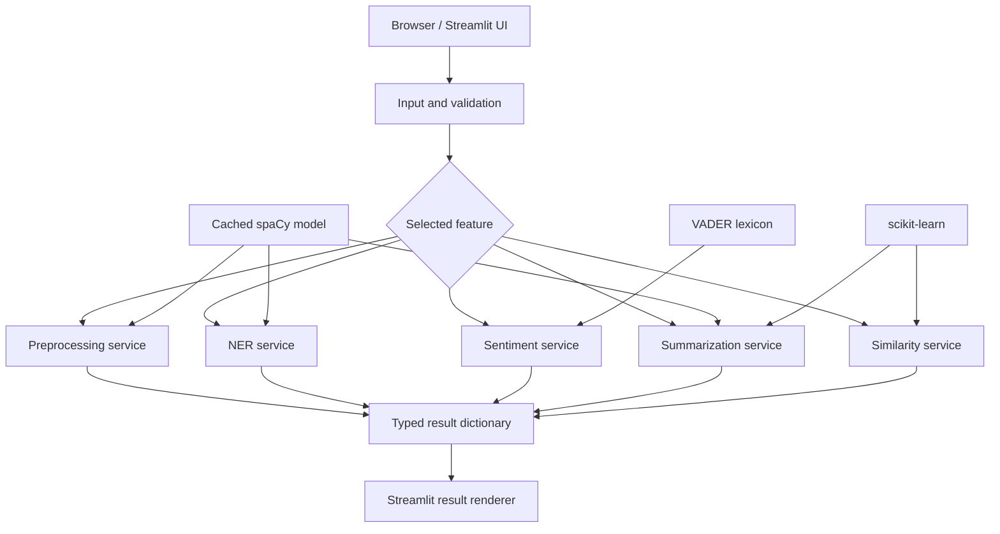

# LexiLab — Complete Engineering Specification

**Document ID:** LXL-ENG-001  
**Version:** 1.0  
**Status:** Implementation-ready specification  
**Application:** Local-first English-language NLP analysis playground  
**Target platform:** Desktop browser via Streamlit  
**Primary implementation language:** Python 3.11  
**Intended audience:** Developer, coding agent, reviewer, and NLP course evaluator

---

## 1. Executive summary

LexiLab is a lightweight, interactive, local-first educational application that accepts English text and demonstrates five natural language processing workflows: (1) preprocessing, (2) named entity recognition, (3) sentiment analysis, (4) extractive summarization, and (5) document similarity. It uses pretrained or classical algorithms, requires no paid APIs or database, and provides clear intermediate outputs so students can explain the transformations during a viva.

**Definition of done:** A user can launch the application with one command, select any module, enter text, receive deterministic and interpretable results, understand any limitations, and repeat the workflow without a network connection after dependencies and models have been installed.

### 1.1 Product objectives

1. Make core NLP concepts visible, not merely produce opaque predictions.
2. Support five syllabus-aligned operations through a consistent, polished interface.
3. Keep all analysis on the local machine; no user text is sent to a remote API by the application.
4. Require no account, authentication, database, external API key, or model training.
5. Be simple enough for one student to maintain and explain.
6. Fail gracefully for empty, malformed, short, and oversized inputs.
7. Include automated tests, reproducible setup instructions, and clear limitations.

### 1.2 Explicit non-goals

- Chatbot, conversational memory, generative LLM, machine translation, speech recognition, OCR, PDF upload, document storage, user profiles, multilingual support, plagiarism detection, production-scale document search, or public multi-tenant hosting.
- Claiming calibrated confidence probabilities for VADER sentiment or NER.
- Claiming semantic equivalence from TF-IDF cosine similarity.
- Claiming that the extractive summary paraphrases or understands the text.

### 1.3 Scope and deliverables

| Deliverable | Required | Notes |
|---|---|---|
| Streamlit UI | Yes | Five tabs/feature pages, consistent design |
| Preprocessing engine | Yes | Tokens, stop words, stemming, lemmatization, POS |
| NER engine | Yes | Entity text, type, offsets, highlighted passage |
| Sentiment engine | Yes | VADER compound and component scores |
| Summarization engine | Yes | Extractive sentence ranking |
| Similarity engine | Yes | TF-IDF cosine comparison of two texts |
| Input validation | Yes | Clear limits and friendly errors |
| Automated tests | Yes | Unit and integration smoke tests |
| README and report guidance | Yes | Reproducible demonstration |
| Database, login, cloud API | No | Explicitly out of scope |

---

## 2. Users and user journeys

### 2.1 Personas

- **Student presenter:** needs explainable intermediate outputs and repeatable examples.
- **Faculty evaluator:** wants to inspect algorithm choice, input, output, correctness, and limitations.
- **Casual learner:** wants to explore how text changes through NLP processing.

### 2.2 Primary journey

1. User launches `streamlit run app.py`.
2. Home page displays LexiLab branding, short explanation, and navigation.
3. User selects a feature.
4. UI displays a labeled input area, short algorithm description, sample-text action, and Analyze button.
5. User enters or loads example text.
6. Application validates input and runs the selected local algorithm.
7. UI displays result summary, details, and a short “How this works” explanation.
8. User edits text and reruns analysis or navigates to another module.

### 2.3 Behavioral requirements

| ID | Requirement | Priority | Verification |
|---|---|---|---|
| FR-001 | Show all five modules in navigation | Must | UI smoke test |
| FR-002 | Analyze only on explicit user action | Must | UI test |
| FR-003 | Provide meaningful example inputs | Must | Manual test |
| FR-004 | Show helpful validation errors | Must | Unit/UI tests |
| FR-005 | Preserve module input during normal Streamlit reruns | Must | Manual test |
| FR-006 | Display algorithm explanations and caveats | Must | Review |
| FR-007 | Show original input unchanged | Must | Unit test |
| FR-008 | Provide loading feedback for slower operations | Should | Manual test |
| FR-009 | Copy/download result as JSON or TXT | Could | Optional enhancement |
| FR-010 | Provide compact and readable light-theme layout | Must | Visual QA |

---

## 3. Technology decisions

### 3.1 Stack

| Component | Selection | Rationale |
|---|---|---|
| Runtime | Python 3.11 | Broad library compatibility |
| UI | Streamlit | Fast, pure-Python interactive interface |
| Linguistic pipeline | spaCy `en_core_web_sm` | Tokenization, lemmas, POS, NER, sentence boundaries |
| Stemmer | NLTK PorterStemmer | Educational stemming demonstration |
| Stop-word list | spaCy English stop words | Avoid extra downloads; consistent tokens |
| Sentiment | NLTK VADER | Lightweight, interpretable rule/lexicon-based sentiment |
| Similarity | scikit-learn `TfidfVectorizer` + `cosine_similarity` | Classical document representation |
| Summarization | Custom extractive TF-IDF sentence scoring | Transparent, no generative model |
| Tests | pytest | Standard Python tests |
| Lint/format | Ruff | Optional but recommended quality gate |
| Persistence | None | No requirement for stored user data |

**Important:** Use version constraints in `requirements.txt`, then generate a lock/freeze file from a tested environment for reproducibility. Do not invent exact latest package versions. The spaCy model must be compatible with the installed spaCy major/minor version.

### 3.2 Dependency installation

Windows PowerShell:

```powershell
mkdir LexiLab
cd LexiLab
py -3.11 -m venv .venv
.\.venv\Scripts\Activate.ps1
python -m pip install --upgrade pip
pip install streamlit spacy nltk scikit-learn pytest ruff
python -m spacy download en_core_web_sm
python -c "import nltk; nltk.download('vader_lexicon')"
```

macOS/Linux:

```bash
python3.11 -m venv .venv
source .venv/bin/activate
python -m pip install --upgrade pip
pip install streamlit spacy nltk scikit-learn pytest ruff
python -m spacy download en_core_web_sm
python -c "import nltk; nltk.download('vader_lexicon')"
```

After successful validation:

```bash
pip freeze > requirements-lock.txt
streamlit run app.py
```

**Offline caveat:** Initial package/model/lexicon installation needs access to package/model distribution sources. Once resources are cached locally, runtime analysis does not require an external API or internet connection. NLTK VADER lexicon must be available in the runtime's NLTK data path.

---

## 4. Architecture

### 4.1 Logical flow



### 4.2 Separation of concerns

- **UI layer (`app.py`, `ui/`):** collects inputs, controls feature selection, renders results, handles user-visible errors. It must not contain NLP algorithms.
- **Service layer (`nlp/`):** pure functions or thin service objects accepting text and returning structured data. It must not import Streamlit.
- **Validation (`core/validation.py`):** centralized input limits, normalization of control whitespace where appropriate, and error types. Do not silently modify original input.
- **Resources (`core/resources.py`):** load and cache expensive models; `@st.cache_resource` belongs in the Streamlit-facing adapter or a wrapper, not inside pure service modules.
- **Tests (`tests/`):** test each algorithm, edge cases, and the end-to-end module contracts.

### 4.3 Recommended directory tree

```text
LexiLab/
├── app.py
├── requirements.txt
├── requirements-lock.txt          # generated after tested install
├── README.md
├── .gitignore
├── .streamlit/
│   └── config.toml
├── assets/
│   └── styles.css
├── core/
│   ├── __init__.py
│   ├── validation.py
│   ├── resources.py
│   └── constants.py
├── nlp/
│   ├── __init__.py
│   ├── preprocessing.py
│   ├── entities.py
│   ├── sentiment.py
│   ├── summarizer.py
│   └── similarity.py
├── ui/
│   ├── __init__.py
│   ├── components.py
│   └── pages.py
├── examples/
│   └── samples.py
├── tests/
│   ├── conftest.py
│   ├── test_validation.py
│   ├── test_preprocessing.py
│   ├── test_entities.py
│   ├── test_sentiment.py
│   ├── test_summarizer.py
│   └── test_similarity.py
└── docs/
    ├── architecture.md
    ├── test-plan.md
    └── viva-notes.md
```

### 4.4 Module contracts

All functions return serializable dictionaries with consistent fields and never return a Streamlit object. Expected failures raise `InputValidationError` with a safe, user-readable message. Unexpected failures are logged without echoing the full user text.

```python
analyze_preprocessing(text: str, nlp) -> dict
extract_entities(text: str, nlp) -> dict
analyze_sentiment(text: str, analyzer) -> dict
summarize_text(text: str, nlp, max_sentences: int = 3) -> dict
compare_documents(text_a: str, text_b: str) -> dict
```

Recommended common result envelope:

```json
{
  "module": "preprocessing",
  "input_characters": 42,
  "result": {},
  "warnings": [],
  "algorithm": "spaCy + PorterStemmer"
}
```

The envelope is a specification, not a claim that the modules already exist.

---

## 5. Input validation and common rules

### 5.1 Input constraints

- General single-text input: **1–10,000 characters** after checking that it contains non-whitespace characters.
- Similarity: each input **1–10,000 characters**; both must be nonempty.
- Summarization: require **at least 2 nonempty sentences**; recommend at least 40 words for useful summaries; warn rather than reject if shorter.
- The UI should display a live character counter and the configured limit.
- Do not strip punctuation before NER, POS tagging, sentiment, or sentence splitting.
- Preserve original text in the result; normalization should be a separate derived representation.
- English is the only supported language; do not pretend to automatically validate language perfectly. Warn that other languages may yield unreliable results.
- Treat text as data, never as code, markup, or instructions.

### 5.2 Security and privacy

- Never call `eval`, `exec`, or a shell command on user text.
- Never render unescaped user input via `unsafe_allow_html=True`.
- For NER highlights, use safe rendering: escape all user-controlled spans with `html.escape` before inserting controlled `<mark>` wrappers, or use a vetted Streamlit-compatible rendering approach.
- Use `st.text`, `st.write` or other escaping widgets wherever possible.
- Do not save user text to files, logs, analytics, or a database.
- Do not expose Streamlit to the public internet by default. Localhost-only operation is the default deployment assumption.
- Cap input size to limit CPU/memory abuse.
- Model files and Python packages are supply-chain dependencies; install from trusted package sources.

### 5.3 Error categories

| Error | Trigger | UI response |
|---|---|---|
| EMPTY_TEXT | Input blank or whitespace | “Enter some English text to analyze.” |
| TEXT_TOO_LONG | Character limit exceeded | “Maximum 10,000 characters.” |
| INSUFFICIENT_SENTENCES | Summary needs at least two sentences | “Add at least two sentences.” |
| EMPTY_VOCABULARY | No usable terms for TF-IDF | “Use text containing letters or words.” |
| MODEL_NOT_INSTALLED | spaCy model missing | Show installation command |
| LEXICON_NOT_INSTALLED | VADER lexicon missing | Show download command |
| UNEXPECTED_ERROR | Other internal failure | Friendly message; log exception type only |

---

## 6. Detailed module specification: preprocessing

### 6.1 Purpose

Demonstrate how raw text is segmented and normalized, including the differences between stemming and lemmatization. It must be visually clear that operations are not always interchangeable and can lose meaning.

### 6.2 Pipeline

1. Accept validated original text.
2. Parse using `nlp(text)`.
3. Produce full token list including punctuation for inspection.
4. Produce alphabetic-token list (`token.is_alpha`) for word-focused operations.
5. Mark stop words using `token.is_stop`; use spaCy's built-in stop-word classification for consistency.
6. Create filtered word list excluding stop words.
7. Compute Porter stems on filtered lowercase words.
8. Compute spaCy lemmas on filtered tokens; lowercase lemmas for normalized display.
9. Extract POS tags (`token.pos_`) and optional fine-grained tags (`token.tag_`).
10. Show counts: characters, sentences, total tokens, alphabetic tokens, stop words, retained words.

### 6.3 Output schema

```json
{
  "module": "preprocessing",
  "input_characters": 38,
  "result": {
    "tokens": ["The", "students", "are", "running", "."],
    "words": ["The", "students", "are", "running"],
    "filtered_words": ["students", "running"],
    "stems": ["student", "run"],
    "lemmas": ["student", "run"],
    "pos_tags": [{"text": "students", "pos": "NOUN", "tag": "NNS"}],
    "stats": {"token_count": 5, "word_count": 4}
  },
  "warnings": [],
  "algorithm": "spaCy + NLTK PorterStemmer"
}
```

Example is illustrative; actual results depend on model/version and input.

### 6.4 UI requirements

- Input panel at top.
- Summary metrics row.
- Five clearly labeled sections: Tokens, Stop-word Removal, Stemming, Lemmatization, POS Tags.
- Tokens displayed as small wrapping chips; POS in a sortable or simple table.
- Optional “Show token-level comparison” table: original, lowercase, stop word?, stem, lemma, POS.
- Educational note: “Stemming cuts words using heuristics; lemmatization uses linguistic analysis.”

### 6.5 Edge cases

Punctuation-only input should not crash; return tokenization but explain that no alphabetic words remain. Emojis and numbers may be retained in raw tokens and excluded from alphabetic word lists. Apostrophes/contractions follow spaCy tokenizer behavior. Do not promise universal contraction expansion; it is not in MVP scope.

---

## 7. Detailed module specification: named entity recognition

### 7.1 Purpose

Identify named spans using spaCy's pretrained English NER component. Typical entity types include `PERSON`, `ORG`, `GPE`, `LOC`, `DATE`, `TIME`, `MONEY`, and others. Actual detection is probabilistic and may miss or mislabel entities.

### 7.2 Algorithm

1. Validate text.
2. Run `doc = nlp(text)`.
3. Iterate over `doc.ents`.
4. For each entity, return exact `text`, `label_`, `start_char`, and `end_char`.
5. Group counts by entity label.
6. Render annotated text with safely escaped original spans and styled labels.
7. If none found, show “No entities detected” rather than treating this as a failure.

### 7.3 Contract

```json
{
  "module": "entities",
  "input_characters": 41,
  "result": {
    "entities": [
      {"text": "Apple", "label": "ORG", "start": 0, "end": 5},
      {"text": "Mumbai", "label": "GPE", "start": 26, "end": 32}
    ],
    "counts_by_label": {"ORG": 1, "GPE": 1}
  },
  "warnings": [],
  "algorithm": "spaCy en_core_web_sm NER"
}
```

Offsets and labels above are schematic; tests must compute actual offsets from the literal test input, not reuse these example numbers.

### 7.4 UI

- Highlight entities inline using a small accessible color palette.
- Include legend explaining each observed label.
- Include table: Entity, Category, Start, End.
- Explain that `GPE` means geopolitical entity, while `LOC` is another location category.
- Do not display a fabricated confidence score: spaCy's standard `doc.ents` API does not expose a calibrated per-entity probability.

### 7.5 Edge cases

Repeated names must appear as separate spans. No entities is valid. Overlap should not be manually synthesized; `doc.ents` provides non-overlapping spans. Avoid claims of accuracy on unusual company names or code-mixed languages.

---

## 8. Detailed module specification: sentiment analysis

### 8.1 Purpose

Estimate overall sentiment of English text using NLTK VADER, especially useful for short opinion-like passages. This is a lexical/rule-based score, not a factual truth detector or calibrated emotional probability.

### 8.2 Implementation

```python
from nltk.sentiment import SentimentIntensityAnalyzer

analyzer = SentimentIntensityAnalyzer()
scores = analyzer.polarity_scores(text)
compound = scores["compound"]
if compound >= 0.05:
    label = "Positive"
elif compound <= -0.05:
    label = "Negative"
else:
    label = "Neutral"
```

### 8.3 Output

- `compound`: normalized score from -1 to +1.
- `pos`, `neu`, `neg`: proportions of text assigned to VADER's sentiment categories; not calibrated probabilities of the entire text's true sentiment.
- `label`: derived from the thresholds above.
- `warnings`: mention sarcasm, irony, context, domain-specific vocabulary, and mixed opinions as limitations.

### 8.4 UI

- Prominent label and compound score.
- Three compact score cards: positive, neutral, negative.
- Horizontal gauge from -1 to +1 with a zero midpoint.
- Text: “A rule-based sentiment estimate; not a confidence percentage.”

### 8.5 Tests

Use obvious positive and negative test phrases to check expected polarity signs; avoid requiring exact scores except in a pinned environment. Neutral text should be allowed. Emoji and capitalization can influence VADER scores; retain punctuation and casing.

---

## 9. Detailed module specification: extractive summarization

### 9.1 Purpose and design

Produce a shorter version of an input passage by selecting original sentences. The MVP uses a deterministic TF-IDF ranking approach; it does not paraphrase or generate new sentences. It is best for multi-sentence informational text.

### 9.2 Exact algorithm

1. Validate the input and parse sentence boundaries with spaCy (`list(doc.sents)`).
2. Trim empty sentences and require at least two.
3. Set requested sentence count `k` from UI, default 3, range 1–5; clamp to `< number of input sentences` so output is shorter than the original.
4. Convert each sentence to a string and build a TF-IDF matrix with `TfidfVectorizer(stop_words='english', lowercase=True, token_pattern=r'(?u)\b\w\w+\b')`.
5. Compute one salience score per sentence as the sum of its TF-IDF weights (use `matrix.sum(axis=1)`); optionally normalize by square root of the number of nonzero features to reduce sentence-length bias. **MVP decision: apply the square-root normalization.**
6. Rank sentences by descending score; break ties by original sentence index ascending.
7. Select the top `k` indices, then sort them by original position to preserve reading order.
8. Join selected original sentences with spaces.
9. Return summary, selected sentence indices, sentence scores, original/summary word counts, and compression ratio.
10. If TF-IDF raises an empty-vocabulary error, show a helpful error rather than crashing.

**Score definition:** `score_i = sum(TFIDF_i) / sqrt(max(1, count_nonzero(TFIDF_i)))`.

**Compression:** `1 - summary_word_count / original_word_count`, reported as a fraction or percent; do not assume it is always positive for unusual tokenization. Because selected sentences come from the original, word count normally decreases when `k < n`.

### 9.3 UI

- Multiline text area with recommendation “Use at least 4–5 sentences.”
- Number-of-sentences slider (1–5), clamped to valid range.
- Summary card, original and summary word counts, compression percentage.
- Expandable “Why these sentences?” table with rank, score, and original index.
- Educational warning: “Extractive summarization may omit context and cannot guarantee factual completeness.”

### 9.4 Edge cases

- One sentence: reject with guidance.
- Two sentences and k=3: clamp to 1 and explain the adjustment.
- Text with only stop words: empty-vocabulary error.
- Duplicate sentences: stable tie-breaking.
- Very long sentence: show potential limitation rather than silently truncating content.

---

## 10. Detailed module specification: document similarity

### 10.1 Purpose

Compare two English texts using bag-of-words TF-IDF vectors and cosine similarity. This is lexical overlap-based similarity, not a plagiarism verdict and not reliable semantic equivalence.

### 10.2 Algorithm

1. Validate both inputs independently.
2. Create one `TfidfVectorizer(lowercase=True, stop_words='english', ngram_range=(1, 2), token_pattern=r'(?u)\b\w\w+\b')`.
3. Fit the vectorizer jointly on `[text_a, text_b]`.
4. Compute `cosine_similarity(matrix[0:1], matrix[1:2])[0, 0]`.
5. Clamp tiny floating-point deviations to `[0, 1]` for display.
6. Show score as `0.00–1.00` and as `0–100% lexical similarity`.
7. Extract shared normalized features from the two sparse rows and show up to 10 shared terms/ngrams sorted by combined TF-IDF weight.
8. Handle empty vocabulary with a validation error.

### 10.3 Interpretation

- 1.0: identical TF-IDF direction under the chosen vocabulary; not necessarily identical strings.
- 0.0: no shared features after preprocessing.
- Intermediate values: overlap under this specific vectorizer and two-document corpus.
- Do not invent fixed categories such as “plagiarized” or “same meaning.” If qualitative badges are used, label them heuristic only; the MVP should avoid them.

### 10.4 UI

- Two side-by-side input areas on wide screens; stack on narrow screens.
- Similarity gauge, numeric score, top shared features, and method description.
- Include contrasting example pairs: identical, partially overlapping, and unrelated.

### 10.5 Tests

Identical nonempty meaningful text should yield approximately 1.0. Disjoint vocabulary should yield approximately 0.0. Symmetry must hold: `sim(a,b) == sim(b,a)` within tolerance. Whitespace-only and stop-word-only inputs should not crash.

---

## 11. UX and visual design specification

### 11.1 Layout

- Page title: `LexiLab` with subtitle “Explore how machines process language.”
- Desktop centered content max width approximately 1100–1200 px.
- Sidebar: Overview, Preprocessing, Named Entities, Sentiment, Summarization, Similarity, About.
- Main content: feature title, 1-sentence explanation, input card, primary Analyze action, results card, expandable explanation.
- Use `st.form` for each feature to prevent expensive analysis on every keystroke.
- Keep Streamlit widget keys unique per module; use `st.session_state` for preserving inputs.

### 11.2 Design tokens

| Token | Value |
|---|---|
| Page background | `#F8FAFC` |
| Surface | `#FFFFFF` |
| Primary text | `#0F172A` |
| Secondary text | `#64748B` |
| Primary accent | `#4F46E5` |
| Positive | `#16A34A` |
| Negative | `#DC2626` |
| Border | `#E2E8F0` |
| Corner radius | 12–16 px |
| Spacing scale | 4, 8, 12, 16, 24, 32 px |
| Body font | System sans-serif |

Ensure WCAG-aware contrast, visible focus states, and text labels in addition to colors. Use restrained shadows and no distracting animations.

### 11.3 Wireframe

```text
┌──────────────────────────────────────────────────────────────┐
│ LexiLab                           Local-first NLP Playground │
├──────────────┬───────────────────────────────────────────────┤
│ Overview     │  [Feature title]                              │
│ Preprocess   │  Short explanation                            │
│ Entities     │  ┌─────────────────────────────────────────┐  │
│ Sentiment    │  │ Text input                              │  │
│ Summarize    │  │                                         │  │
│ Similarity   │  └─────────────────────────────────────────┘  │
│ About        │  [Load example]  [Analyze text]               │
│              │  ┌─────────────────────────────────────────┐  │
│              │  │ Summary metrics / result               │  │
│              │  │ Details and visual breakdown           │  │
│              │  └─────────────────────────────────────────┘  │
│              │  How it works ▾                              │
└──────────────┴───────────────────────────────────────────────┘
```

### 11.4 States

- Initial: sample suggestion, no fake computed result.
- Editing: character count, no automatic execution.
- Loading: spinner or status while processing.
- Success: result plus explanation.
- Empty result: explicit “No entities found” or similar.
- Validation error: concise, actionable warning.
- Runtime failure: safe error without traceback in UI.

### 11.5 Responsive behavior

On narrow viewports, collapse sidebar, stack two-column inputs, wrap token chips, avoid horizontal scrolling in result cards, and allow tables to scroll within their container.

---

## 12. Implementation details and reference pseudocode

### 12.1 Resource initialization

```python
import streamlit as st
import spacy
from nltk.sentiment import SentimentIntensityAnalyzer

@st.cache_resource(show_spinner="Loading English NLP model...")
def load_spacy_model():
    return spacy.load("en_core_web_sm")

@st.cache_resource(show_spinner=False)
def load_vader():
    return SentimentIntensityAnalyzer()
```

Avoid caching raw user inputs indefinitely with `st.cache_data`; the app does not require retaining text-derived results beyond the current session. `st.cache_resource` shares loaded resources across sessions, so treat the loaded spaCy pipeline as read-only and do not mutate it per request.

### 12.2 Validation pseudocode

```python
MAX_CHARS = 10_000

class InputValidationError(ValueError):
    pass

def validate_text(text: str, field: str = "Text") -> str:
    if not isinstance(text, str):
        raise InputValidationError(f"{field} must be a string.")
    if not text.strip():
        raise InputValidationError(f"Enter {field.lower()} to analyze.")
    if len(text) > MAX_CHARS:
        raise InputValidationError(f"{field} exceeds {MAX_CHARS:,} characters.")
    return text
```

### 12.3 Preprocessing pseudocode

```python
from nltk.stem import PorterStemmer

stemmer = PorterStemmer()

def analyze_preprocessing(text, nlp):
    text = validate_text(text)
    doc = nlp(text)
    words = [t for t in doc if t.is_alpha]
    filtered = [t for t in words if not t.is_stop]
    return {
        "tokens": [t.text for t in doc],
        "words": [t.text for t in words],
        "filtered_words": [t.text for t in filtered],
        "stems": [stemmer.stem(t.lower_) for t in filtered],
        "lemmas": [t.lemma_.lower() for t in filtered],
        "pos_tags": [
            {"text": t.text, "pos": t.pos_, "tag": t.tag_}
            for t in words
        ],
    }
```

### 12.4 NER pseudocode

```python
def extract_entities(text, nlp):
    text = validate_text(text)
    doc = nlp(text)
    entities = [
        {"text": e.text, "label": e.label_,
         "start": e.start_char, "end": e.end_char}
        for e in doc.ents
    ]
    return {"entities": entities}
```

### 12.5 Sentiment pseudocode

```python
def analyze_sentiment(text, analyzer):
    text = validate_text(text)
    scores = analyzer.polarity_scores(text)
    c = scores["compound"]
    label = "Positive" if c >= 0.05 else "Negative" if c <= -0.05 else "Neutral"
    return {"label": label, "scores": scores}
```

### 12.6 Similarity pseudocode

```python
from sklearn.feature_extraction.text import TfidfVectorizer
from sklearn.metrics.pairwise import cosine_similarity

def compare_documents(text_a, text_b):
    text_a = validate_text(text_a, "Text A")
    text_b = validate_text(text_b, "Text B")
    vectorizer = TfidfVectorizer(
        lowercase=True, stop_words="english", ngram_range=(1, 2),
        token_pattern=r"(?u)\b\w\w+\b"
    )
    matrix = vectorizer.fit_transform([text_a, text_b])
    score = float(cosine_similarity(matrix[0:1], matrix[1:2])[0, 0])
    return {"score": max(0.0, min(1.0, score))}
```

### 12.7 Summarization pseudocode

```python
import math
import numpy as np
from sklearn.feature_extraction.text import TfidfVectorizer

def summarize_text(text, nlp, max_sentences=3):
    text = validate_text(text)
    sentences = [s.text.strip() for s in nlp(text).sents if s.text.strip()]
    if len(sentences) < 2:
        raise InputValidationError("Add at least two sentences to summarize.")
    k = min(max(1, int(max_sentences)), 5, len(sentences) - 1)
    vectorizer = TfidfVectorizer(stop_words="english")
    matrix = vectorizer.fit_transform(sentences)
    scores = []
    for i in range(matrix.shape[0]):
        row = matrix.getrow(i)
        scores.append(float(row.sum()) / math.sqrt(max(1, row.nnz)))
    ranked = sorted(range(len(sentences)), key=lambda i: (-scores[i], i))
    chosen = sorted(ranked[:k])
    summary = " ".join(sentences[i] for i in chosen)
    return {"summary": summary, "selected_indices": chosen,
            "sentence_scores": scores, "sentence_count": len(sentences)}
```

`numpy` is a transitive dependency of scikit-learn and is not actually used in this reference snippet; remove its import in the final implementation. The final function must additionally compute word counts, compression, warnings, and the common result envelope. Ensure the spaCy pipeline retains the parser or sentence boundary component.

### 12.8 Streamlit app flow

```python
import streamlit as st

st.set_page_config(page_title="LexiLab", page_icon="🧠", layout="wide")
feature = st.sidebar.radio("Explore", [
    "Overview", "Preprocessing", "Named Entities",
    "Sentiment", "Summarization", "Similarity", "About"
])
# Delegate each page to a ui.pages function.
# Each feature page owns its st.form, validation, call to service, and result display.
# Never execute analysis solely because a text area changed.
```

---

## 13. Performance and reliability

### 13.1 Targets (design goals, not measured benchmarks)

| Operation | Target on a typical modern laptop, <= 2,000 chars |
|---|---|
| Preprocessing | Under 2 seconds after model load |
| NER | Under 2 seconds after model load |
| VADER sentiment | Under 1 second |
| Similarity | Under 2 seconds |
| Summarization | Under 3 seconds |
| App cold startup | Under 15 seconds, environment dependent |

These are aspirational targets. Benchmark on the actual demonstration machine; do not claim they have been validated until measured. For 10,000-character inputs, allow higher latency and show a spinner.

### 13.2 Reliability requirements

- One failed analysis must not terminate the Streamlit process.
- Model load errors should give exact remediation instructions.
- Avoid unnecessary repeated model loads across reruns.
- No uncontrolled file writes or temporary files containing text.
- Preserve module state using stable keys.
- Use bounded input sizes and avoid quadratic UI rendering of long token lists.

---

## 14. Testing strategy

### 14.1 Test layers

1. **Unit:** input validation and each NLP function.
2. **Contract:** output keys, data types, score ranges, offsets, and ordering.
3. **Integration:** real spaCy model and VADER lexicon loaded successfully.
4. **UI smoke:** all feature pages render; Analyze actions display results; errors are readable.
5. **Manual exploratory:** Unicode, emojis, punctuation, long passages, narrow screen, repeated navigation.

### 14.2 Acceptance test matrix

| ID | Feature | Input | Expected invariant |
|---|---|---|---|
| T-01 | Validation | Empty string | Clear validation error |
| T-02 | Validation | 10,001 characters | Rejected |
| T-03 | Preprocessing | `The students are running.` | Tokens and word forms returned |
| T-04 | Preprocessing | `!!!` | No crash; empty word list |
| T-05 | NER | `Apple opened an office in Mumbai.` | Entity objects with valid spans; labels model-dependent |
| T-06 | NER | `the and of` | Valid empty result allowed |
| T-07 | Sentiment | `I absolutely love this!` | Positive compound/label |
| T-08 | Sentiment | `This is terrible.` | Negative compound/label |
| T-09 | Sentiment | Any valid text | Scores in documented ranges |
| T-10 | Summary | One sentence | Friendly error |
| T-11 | Summary | Five informational sentences | Output contains selected original sentences only |
| T-12 | Summary | Duplicate sentences | Stable ranking |
| T-13 | Similarity | Same meaningful text twice | Score approximately 1 |
| T-14 | Similarity | Disjoint meaningful vocabularies | Score approximately 0 |
| T-15 | Similarity | Inputs reversed | Symmetric score |
| T-16 | Similarity | Stop-word-only text | Empty-vocabulary handled |
| T-17 | UI | Switch feature | No accidental analysis |
| T-18 | Security | `<script>alert(1)</script>` | Displayed as inert text; no execution |
| T-19 | Offline | Disconnect network after setup | All five modules still run |
| T-20 | Privacy | Run sample input | No user text written to logs/files |

### 14.3 Example pytest assertions

```python
import pytest

def test_similarity_is_symmetric():
    a = "The quick brown fox jumps over a log."
    b = "A brown fox leaps across the log."
    ab = compare_documents(a, b)["score"]
    ba = compare_documents(b, a)["score"]
    assert ab == pytest.approx(ba, abs=1e-10)

def test_similarity_identical():
    text = "Natural language processing analyzes written language."
    assert compare_documents(text, text)["score"] == pytest.approx(1.0)
```

If the production service returns the common envelope, tests must read `result["result"]["score"]` instead; choose one canonical contract and update tests consistently before implementation. **Canonical final contract: use the common envelope from §4.4 for every module.**

### 14.4 Quality gates

```bash
python -m pytest -q
ruff check .
ruff format --check .
```

Completion requires all tests passing, zero uncaught errors in the manual demo, and no unverified claims in the README.

---

## 15. Implementation milestones and exact work order

### Milestone 0 — Bootstrap

- [ ] Create repository and directory structure.
- [ ] Create virtual environment and install dependencies.
- [ ] Download compatible spaCy model and VADER lexicon.
- [ ] Add `.gitignore` (`.venv/`, `__pycache__/`, `.pytest_cache/`, `.streamlit/secrets.toml`, generated files).
- [ ] Confirm model and lexicon can be loaded from Python.

**Exit:** clean environment can import all dependencies.

### Milestone 1 — Shared foundation

- [ ] Implement `InputValidationError` and `validate_text`.
- [ ] Define constants and canonical result envelope.
- [ ] Add resource-loading wrappers.
- [ ] Write validation tests.

**Exit:** shared validation tests pass.

### Milestone 2 — Five NLP engines

Implement in this order: preprocessing → entities → sentiment → similarity → summarizer.

For each:
- [ ] Implement algorithm exactly as specified.
- [ ] Return canonical result envelope.
- [ ] Handle empty/unsupported meaningful content.
- [ ] Add unit tests and at least one manual example.
- [ ] Document algorithm limitations.

**Exit:** all five engines work without Streamlit.

### Milestone 3 — UI shell

- [ ] Add page config and navigation.
- [ ] Build shared title, input, metric, warning, and explanation components.
- [ ] Implement CSS and mobile-safe layout.
- [ ] Implement stable session-state keys.

**Exit:** navigation works and no module logic lives in the UI.

### Milestone 4 — Feature pages

- [ ] Add forms and result renderers for each module.
- [ ] Add example text buttons and reset controls.
- [ ] Add token chips, entity highlights, sentiment gauge, summary cards, similarity score.
- [ ] Add progress/error/empty states.
- [ ] Validate all user text is safely rendered.

**Exit:** all five flows work from browser to NLP engine and back.

### Milestone 5 — Verification

- [ ] Run unit and integration tests.
- [ ] Execute acceptance matrix T-01 through T-20.
- [ ] Test on narrow and desktop screens.
- [ ] Test with network disabled after installation.
- [ ] Record startup and feature timings on target machine.
- [ ] Fix UI inconsistencies and exceptions.

**Exit:** documented test results and reproducible demo.

### Milestone 6 — Delivery

- [ ] Finalize README with setup/run/troubleshooting.
- [ ] Capture screenshots of five modules.
- [ ] Write brief architecture and algorithms explanation.
- [ ] Prepare a 3–5 minute viva demo.
- [ ] Commit source and lock file; exclude virtual environment and caches.

**Exit:** evaluator can clone, install, run, and inspect the project.

---

## 16. Demonstration script

**0:00–0:30:** Introduce LexiLab, problem statement, and local-first architecture.  
**0:30–1:15:** Preprocessing: enter “The students are running quickly.” Show tokens, stems, lemmas, POS.  
**1:15–1:50:** NER: enter “Apple opened an office in Mumbai in 2025.” Explain entity types.  
**1:50–2:20:** Sentiment: contrast “I love this product!” and “I hate this product!” Explain VADER compound.  
**2:20–3:10:** Summarization: paste five sentences; show selected originals and compression.  
**3:10–4:00:** Similarity: compare identical, related, and unrelated sentences; explain TF-IDF and cosine.  
**4:00–5:00:** Explain limitations, tests, offline execution, and syllabus mapping.

Use test phrases to demonstrate algorithms, but do not promise specific NER entities or sentiment values without checking the actual installed model.

---

## 17. Syllabus traceability

| Unit | Syllabus topic | LexiLab implementation |
|---|---|---|
| 1 | NLP pipeline, components, libraries | Shared validation → algorithm → result UI |
| 2 | POS tagging, morphology, NER | spaCy POS, lemma, named entities |
| 3 | Tokenization, stop words, stemming, lemmatization | Preprocessing page |
| 4 | Classification, summarization, information extraction | VADER, extractive TF-IDF, NER |
| 5 | Document similarity and distance metrics | TF-IDF + cosine similarity |
| 6 | Machine translation | Not implemented; explicitly outside scope |

**Important:** The project illustrates selected topics in five units; it does not comprehensively cover every topic within those units.

---

## 18. Risks, trade-offs, and mitigations

| Risk | Impact | Mitigation |
|---|---|---|
| Model installation mismatch | App fails to load | Test Python/spaCy/model versions together and freeze environment |
| VADER misreads sarcasm | Incorrect sentiment | Show limitation; avoid accuracy claims |
| NER mislabels entities | Misleading demo | Test representative inputs; explain probabilistic tagging |
| TF-IDF misses synonyms | Similar meaning gets low score | Explain lexical, not semantic, similarity |
| Extractive summary loses context | Incomplete summary | Preserve original sentences and show selected indices |
| Stop-word-only text | Empty TF-IDF vocabulary | Catch and explain exception |
| Long input causes lag | Poor UX | Enforce 10,000-character cap; show spinner |
| Raw HTML injection | Browser security risk | Escape input; never render raw text as trusted HTML |
| Streamlit rerun resets state | Frustrating UX | Stable widget keys/session state |
| Overengineering | Delayed completion | Freeze MVP scope; defer optional features |

### 18.1 Architecture alternatives considered

- **React + FastAPI:** more flexible UI but unnecessary complexity, multiple runtimes, and extra deployment work. Rejected for MVP.
- **Transformer-based sentiment/summarization:** may provide more sophisticated outputs but increases model size, latency, installation complexity, and explanation burden. Rejected for MVP.
- **Sentence embeddings for similarity:** captures more semantic relationships but requires an additional pretrained model and changes the educational focus. Deferred.
- **Cloud NLP APIs:** introduce credentials, cost, internet dependence, and data transfer. Rejected.

---

## 19. Documentation requirements

### 19.1 README sections

1. Project title and 2-sentence overview.
2. Screenshots of the application.
3. Features and underlying algorithms.
4. Python and system prerequisites.
5. Windows and macOS/Linux installation commands.
6. Downloading spaCy model and VADER lexicon.
7. Running Streamlit locally.
8. Running tests and formatting checks.
9. Known limitations and privacy model.
10. Directory structure.
11. Course syllabus mapping.
12. License/attribution for third-party libraries and models.

### 19.2 Viva questions to prepare

- What is NLP and why does preprocessing matter?
- What is the difference between a token, stem, and lemma?
- Why do we remove stop words for some tasks but not sentiment or NER?
- What is POS tagging?
- What is NER? How do `ORG`, `GPE`, and `PERSON` differ?
- How does VADER calculate a sentiment score? What does `compound` mean?
- Why is VADER not a deep learning model?
- What is TF-IDF? What does IDF down-weight?
- What is cosine similarity and what are its limitations?
- How does extractive summarization differ from abstractive summarization?
- Why is LexiLab local-first and why is there no database?
- What happens with unsupported languages, sarcasm, and extremely short text?

---

## 20. Final acceptance checklist

### Functional

- [ ] All five modules work from the UI.
- [ ] All services have consistent documented result structures.
- [ ] No API key, database, or internet connection needed at runtime after setup.
- [ ] Input validation and error messages work.
- [ ] Sample text and manual text both work.
- [ ] No fake or hard-coded NLP outputs shown as computed results.

### Engineering

- [ ] Model resources loaded once per running app process when feasible.
- [ ] No raw user text in logs or saved files.
- [ ] UI and algorithm modules are separated.
- [ ] Tests pass in the pinned environment.
- [ ] App runs with `streamlit run app.py`.
- [ ] README installation instructions verified on a clean environment.

### Presentation

- [ ] Responsive, readable UI with consistent typography and spacing.
- [ ] All results include a short explanation.
- [ ] Limitations clearly stated.
- [ ] Five-minute demo rehearsed.
- [ ] Screenshots and syllabus mapping prepared.

---

## 21. Suggested implementation handoff to a coding agent

> Build LexiLab exactly according to this engineering specification. Use Python 3.11, Streamlit, spaCy `en_core_web_sm`, NLTK VADER and PorterStemmer, and scikit-learn. Implement the complete directory structure and all five features. Keep the NLP engines independent of Streamlit and standardize all public service results using the envelope in §4.4. Follow the exact algorithms and error-handling rules in §§5–10, use the design system in §11, and complete milestones sequentially. Write tests for the acceptance matrix, run them, and report actual outcomes rather than claiming unexecuted tests passed. Do not add authentication, a database, paid APIs, LLMs, or unrequested features. Do not present mock results as live analysis. Provide a working README and startup instructions.

---

## 22. Definition of finished project

LexiLab is finished only when a reviewer can create the environment, install the model resources, launch the Streamlit application, perform all five NLP operations, see understandable and accurate-to-the-algorithm outputs, reproduce test results, and read clear limitations without asking the developer to fill in missing architectural decisions.

**End of engineering specification — LXL-ENG-001 v1.0**
