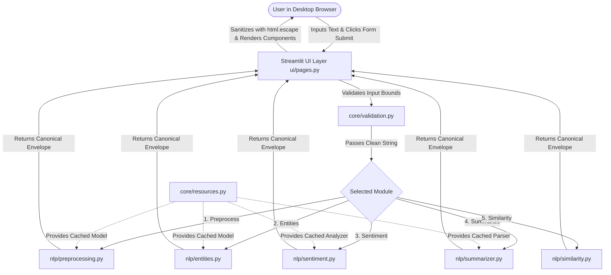

# LexiLab — System Architecture & Design Document

**Document ID:** LXL-ARCH-001  
**Version:** 1.0  
**Target:** Local Python 3.11 + Streamlit Desktop Environment  

---

## 1. Architectural Philosophy

LexiLab is architectured around three non-negotiable principles:
1. **Layer Decoupling:** Complete separation between the UI presentation layer, the core validation/caching layer, and the algorithmic service layer.
2. **Pure Service Engines:** All NLP engines are deterministic pure functions taking standard Python strings and returning typed, JSON-compliant canonical result dictionaries.
3. **Local-First & Zero Network Overhead:** Post-setup execution is 100% self-contained and offline.

---

## 2. Logical Data Flow

---

## 3. Layer Breakdown & Responsibilities

### 3.1 Presentation Layer (`app.py`, `ui/`)
- **`app.py`:** Application entry point. Configures layout (`wide`), loads `assets/styles.css`, renders sidebar navigation, and acts as top-level error boundary.
- **`ui/pages.py`:** Contains view renderers for each of the 7 sections (`Overview`, `Preprocessing`, `Named Entities`, `Sentiment`, `Summarization`, `Similarity`, `About`). Every page uses `st.form` to ensure explicit user trigger.
- **`ui/components.py`:** Reusable UI components including headers, metric rows, token chips, sentiment horizontal gauge, explanation accordions, and `build_safe_entity_html` (strict HTML-escaped entity highlight renderer).

### 3.2 Service Layer (`nlp/`)
- Pure Python functions with **zero** Streamlit imports.
- Functions:
  - `analyze_preprocessing(text: str, nlp) -> dict`
  - `extract_entities(text: str, nlp) -> dict`
  - `analyze_sentiment(text: str, analyzer) -> dict`
  - `summarize_text(text: str, nlp, max_sentences: int) -> dict`
  - `compare_documents(text_a: str, text_b: str) -> dict`
- Standardized return format: Canonical Result Envelope.

### 3.3 Core & Validation Layer (`core/`)
- **`core/constants.py`:** Constants, limits (10,000 chars, 2 sentences min), threshold values, entity descriptions, algorithm identifiers, and `make_envelope()`.
- **`core/validation.py`:** `InputValidationError(ValueError)`, `validate_text()`, `validate_sentence_count()`.
- **`core/resources.py`:** Thread-safe resource caching adapter utilizing `@st.cache_resource` when running under Streamlit, with fallback for pure pytest environments.

---

## 4. Security & Privacy Guarantees

1. **XSS Prevention:** User input is strictly treated as untrusted text. In entity rendering, all text slices are sanitized with Python's built-in `html.escape()` prior to insertion into `<mark>` elements.
2. **Zero Code Execution:** No `eval()`, `exec()`, or dynamic shell invocations.
3. **No Data Persistence:** User text is never saved to databases, temporary disk files, or cloud telemetry.
4. **Denial-of-Service Defense:** Input size is capped at 10,000 characters and summarization output is bounded at 5 sentences to prevent CPU lockups.
